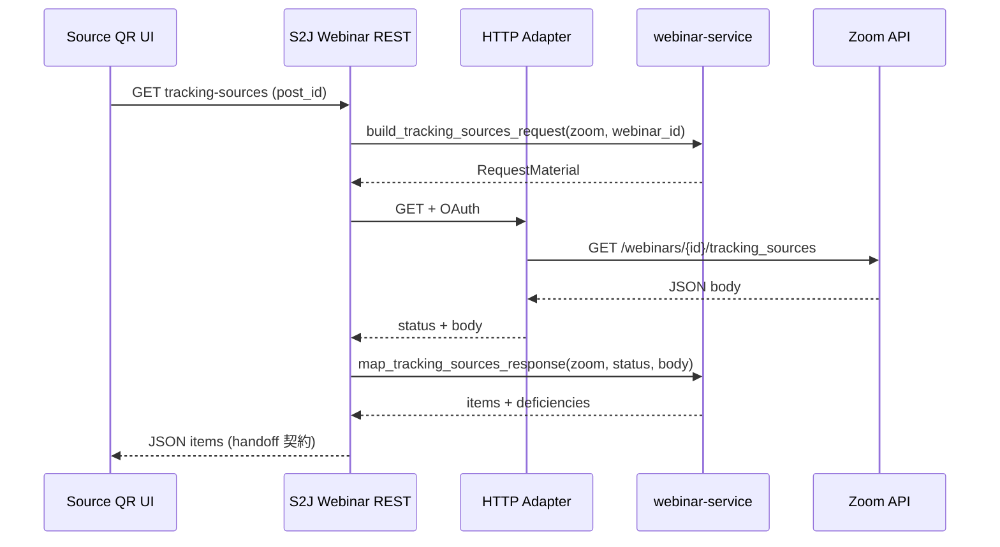

<!--
目的：「Source Tracking GET 取り込み (初版 zoom)」の明文化
-->

# S2J Webinar Service - Source Tracking 取り込み写像

← 索引は [../specs.md](../specs.md)。

本ファイルは **プロバイダ `zoom` 記述子** の Source Tracking **一覧 GET** 写像正本です (v0.0.2)。**Webinar 同期パイプライン (`plan` / `build_webinar_request`) とは別系統** です。

## 設計意図 (ゴール)

接続先 API が返すソース追跡リンク一覧を、プラグイン REST が Source QR に渡す **正規化 DTO** (`source_name` + `registration_url`) に写すこと。

## 非責務

* ソース追跡リンクの **作成・更新・削除** (v0.0.2 `zoom`: REST 作成不可。[Webinar 調査](https://github.com/stein2nd/s2j-webinar/blob/main/docs_mod/v0.0.2/README.md))
* QR 符号化、メディア、`_s2j_webinar_source_qr` 文書 ([Source QR docs](https://github.com/stein2nd/s2j-webinar-source-qr/tree/main/docs))
* OAuth token 保存、HTTP 実行 (S2J Webinar プラグイン)
* `registration_url` のクエリー改変 (付け足し・ UTM 上書き禁止。[glossary](https://github.com/stein2nd/s2j-webinar/blob/main/docs_mod/v0.0.2/glossary.md))
* Webinar レコード `status` / `dirty` / `last_sent` の更新

## 呼び出しフロー



Source QR は **Service を直接 require しなくてよい** (写像済み JSON だけ受け取る)。S2J Webinar は Composer で本ライブラリを require し、上記2関数を呼ぶ。

## レジストリ拡張

[survey_map_spec.md](./survey_map_spec.md) と同様、**独立 Adapter フィールドは置きません。** 記述子の関数を2本追加します (初版は `zoom` のみ実装)。

| 関数 | 用途 |
| --- | --- |
| `build_tracking_sources_request` | `webinar_id` → GET 用 [RequestMaterial](./request_spec.md) |
| `map_tracking_sources_response` | HTTP status + body → 正規化 `items[]` |

未知 `provider` は lookup 失敗で **`provider_unsupported`**。`build_webinar_request` / `map_webinar_response` には **載せない**。

[provider_spec.md](./provider_spec.md) の Zoom 表から本写像にリンクします。

## 公開 PHP API

索引: [../interfaces/tracking_import_php_api.md](../interfaces/tracking_import_php_api.md)、[../interfaces/php_api_spec.md](../interfaces/php_api_spec.md)。

| 種別 | 公開関数 | 委譲先 |
| --- | --- | --- |
| レジストリ・ファサード | `build_tracking_sources_request` | `lookupProvider` → 記述子 `build_tracking_sources_request` |
| レジストリ・ファサード | `map_tracking_sources_response` | 同上 → `map_tracking_sources_response` |

```php
/**
 * @return array{
 *   material?: array{method: string, path: string, body: array<string, mixed>|null},
 *   deficiencies: list<string>
 * }
 */
function build_tracking_sources_request(string $provider, string $webinar_id): array;

/**
 * @param int $status HTTP ステータス (プラグインが wp_remote_* から渡す)
 * @param string $body 応答ボディ (生 JSON 文字列。空可)
 * @return array{
 *   items: list<array{source_name: string, registration_url: string, external_id?: string}>,
 *   deficiencies: list<string>
 * }
 */
function map_tracking_sources_response(string $provider, int $status, string $body): array;
```

### `build_tracking_sources_request` の戻り

| ケース | 戻り |
| --- | --- |
| 成功 | `deficiencies` 空。`material.method` = `GET`。body = `null` |
| 未知 `provider` | `deficiencies: ['provider_unsupported']` |
| `webinar_id` が trim 後空 | `deficiencies: ['tracking_webinar_id_empty']`。**例外にしない** |

### `map_tracking_sources_response` の戻り

| ケース | 戻り |
| --- | --- |
| `HTTP 2xx`、解析成功、有効行が1件以上 | `items` に正規化行。`deficiencies` 空 |
| `HTTP 2xx`、解析成功、有効行0 | `items: []`、`deficiencies: ['tracking_sources_empty']` |
| 未知 `provider` | `items: []`、`deficiencies: ['provider_unsupported']` |
| ステータスが2xx 以外 | `items: []`、`deficiencies: ['tracking_http_error']` (status はログ用。レスポンスに載せない) |
| JSON 不正、トップが配列でない | `items: []`、`deficiencies: ['tracking_body_invalid']` |

**行の扱い:** 配列要素のうち `source_name` と `tracking_url` (下記) が両方有効な行だけ `items` に載せる。不正行は **黙って捨てる** (部分成功)。捨てた行の詳細はユーザー向けに出さない。

## 正規化 DTO (`items[]`)

[S2J Webinar handoff REST](https://github.com/stein2nd/s2j-webinar/blob/main/docs_mod/v0.0.2/source_qr_handoff_spec.md) と [Source QR persistence](https://github.com/stein2nd/s2j-webinar-source-qr/blob/main/docs/persistence_spec.md) と一致させます。

| フィールド | 型 | 規則 |
| --- | --- | --- |
| `source_name` | string | trim 後非空。改行なし |
| `registration_url` | string | trim 後、`http://` または `https://` で始まる。**接続先が返した URL をそのまま** (クエリー並べ替え等をしない) |
| `external_id` | string | 任意。Zoom の `id` を文字列化 |

`source_name` とイベントチャネル `id` の **マッチングは Source QR 側** (完全一致)。本ライブラリは **写像のみ**。

## プロバイダ `zoom`

### GET リクエスト材料

| 項目 | 値 |
| --- | --- |
| method | `GET` |
| パス | `/v2/webinars/{webinarId}/tracking_sources` |
| パス埋め込み | `{webinarId}` = 引数 `webinar_id` (プラグインが `_s2j_webinar_id` から渡す) |
| body | `null` |

API 参照: [getTrackingSources](https://marketplace.zoom.us/docs/api-reference/zoom-api/methods/#operation/getTrackingSources)。実装着手時に再確認。

### OAuth スコープ

Marketplace アプリに必要な OAuth スコープ名は、**実装着手時に Zoom ドキュメントで確定** します (本 spec では列挙しません)。

Zoom が **401や403** など、成功系 (2xx) 以外の HTTP ステータスを返したときの扱いは次のとおりです。

1. **S2J Webinar プラグイン** が HTTP を実行し、受け取ったステータスコードと応答ボディを `map_tracking_sources_response` に渡す。
2. 本ライブラリは `items` を空にし、`deficiencies` に **`tracking_http_error`** を載せる (401と403を分ける専用コードは v0.0.2では置かない)。
3. プラグインは i18n のメッセージだけを画面に出し、生の Zoom 応答や token は載せない。

### 応答ボディ写像

Zoom が返す配列 (または `tracking_sources` キー配下) の **実例差** があるため、初版写像は次の **両方** を許容します (実装時に PHPUnit で固定)。

1. **トップレベル JSON 配列** — 各要素がオブジェクト。
2. **オブジェクトラップ** — `{ "tracking_sources": [ ... ] }` のみ (他キーは無視)。

各要素からのキー写像:

| Zoom (API) | 正規化 DTO |
| --- | --- |
| `source_name` | `source_name` |
| `tracking_url` | `registration_url` |
| `id` | `external_id` (存在時のみ。数値は `(string)`) |

`tracking_url` 以外の URL フィールド (`registration_url` 等) が単独で来た場合は **初版では無視** (写像正本は `tracking_url` のみ)。

### 繰り返しウェビナー

GatherPress **1イベント1Webinar** 想定のため v0.0.2では調査のみ ([Webinar README](https://github.com/stein2nd/s2j-webinar/blob/main/docs_mod/v0.0.2/README.md))。Adapter に特別分岐は置かない。

## 不足コード (tracking 専用)

[validation_spec.md](./validation_spec.md) の Webinar レコード不足とは **別リスト** です。公開関数の `deficiencies` にのみ使います。

| コード | 条件 |
| --- | --- |
| `provider_unsupported` | レジストリに記述子がない |
| `tracking_webinar_id_empty` | `build` 時 `webinar_id` が空 |
| `tracking_http_error` | `map` 時、ステータスが2xx 以外 |
| `tracking_body_invalid` | JSON 解析不能、または許容形でない |
| `tracking_sources_empty` | 2xx だが有効 `items` が0件 |

プラグインは code を i18n メッセージに変換し、生 body を出さない。

## テスト観点

* `zoom` + 有効 `webinar_id` → GET material のパスに ID が埋まる。
* 配列 JSON → `items` 件数と写像フィールド。
* ラップ JSON `{ tracking_sources: [...] }` → 同上。
* 行に `tracking_url` 欠落 → その行だけ落ち、他行は残る。
* 全行不正 → `tracking_sources_empty`。
* 404や401など → `tracking_http_error`、`items` 空。
* 未知 provider → `provider_unsupported` (build / map 両方)。

## 関連

* 契約 DTO: [../contracts/tracking_import_contract.md](../contracts/tracking_import_contract.md)
* プロバイダ・レジストリ: [provider_spec.md](./provider_spec.md)
* リクエスト材料の形: [request_spec.md](./request_spec.md)
* Webinar handoff: [source_qr_handoff_spec.md](https://github.com/stein2nd/s2j-webinar/blob/main/docs_mod/v0.0.2/source_qr_handoff_spec.md)
* PHP 公開面: [../interfaces/tracking_import_php_api.md](../interfaces/tracking_import_php_api.md)

## 改訂履歴

| 日付 | 内容 |
| --- | --- |
| 2026-10-11 | v0.0.2 `zoom` GET 取り込み、公開 API、DTO、不足コードを `docs/core/` に確定 |
